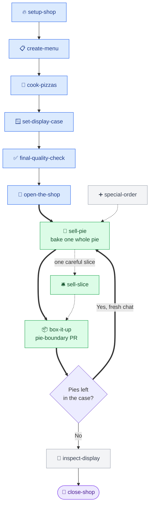

<!-- README.md -->
<!-- ByTheSlice: npm + GitHub README. Pizza-themed, two-tier: simple-at-top + technical-below. -->

<div align="center">

<h1></h1>

**A grab-and-go pizza shop for shipping software.**

*Plan today's menu. Prep the line. Bake one pie at a time, slide it onto the display tray, and keep service moving until the board is clear.*

[](https://www.npmjs.com/package/bytheslice)
[](LICENSE)
[](https://nodejs.org)
[](https://www.anthropic.com/claude-code)
[](https://cursor.com)
[](https://github.com/steve-piece/bytheslice/stargazers)

</div>

---

ByTheSlice runs your project like a **pizza shop**. You don't build a whole app in one prompt - you prep the kitchen, then sell slices to customers one at a time, with quality checks every step of the way. No 200-file PRs nobody reads. No "what does this even do" three months later.

**Three steps. Fourteen commands. The kitchen does the rest.**

---

## Table of Contents

**Start here**
- [How it works - in three steps](#how-it-works-in-three-steps)
- [Quick Start](#quick-start)
- [Install](#install)
- [Watch the kitchen](#watch-the-kitchen)
- [The Pass](#the-pass)

**Under the hood** *(for developers + power agentic-coding users)*
- [The Kitchen - workflow diagram](#the-kitchen-workflow-diagram)
- [The master checklist - Prep + Pies](#the-master-checklist-prep--pies)
- [Personalize - `bytheslice.config.json`](#personalize-bythesliceconfigjson)
- [Architecture & conventions](#architecture--conventions)
- [Experimental skills](#experimental-skills)
- [FAQ](#faq)
- [Contributing](#contributing) · [Repository](#repository) · [License](#license)

---

# Start here

## How it works: in three steps

Think of your project as a pizza shop. There are three things you do, in order. Every command name links to its full reference (`SKILL.md`).

### 🔥 Step 1: Open the shop *(one-time prep)*

Six things, in order, once per project:

| Command | In pizza terms | What it does |
|---|---|---|
| [`/setup-shop`](skills/setup-shop/SKILL.md) | Unlock the doors, fire up the oven. | Bootstraps a new project or drops ByTheSlice into an existing one. |
| [`/create-menu`](skills/create-menu/SKILL.md) | Decide which pies to serve. | Turns a free-form brief into a structured PRD. |
| [`/cook-pizzas`](skills/cook-pizzas/SKILL.md) | Pre-bake every pie on the menu. | Decomposes the PRD into Pies (3-8 slices each) + a nested master checklist. |
| [`/set-display-case`](skills/set-display-case/SKILL.md) | Build the case the pies sit in. | Generates the design system - tokens, components, the `/library` preview route. |
| [`/final-quality-check`](skills/final-quality-check/SKILL.md) | Install the quality line. | Wires CI/CD, E2E tests, design-system compliance, visual regression. |
| [`/open-the-shop`](skills/open-the-shop/SKILL.md) | Flip the OPEN sign, stock ingredients. | Sets up env vars + external service credentials. The most hands-on prep step. |

### 🛎️ Step 2: Serve customers *(the everyday loop)*

Where you'll spend most of your time. **`/sell-pie`** is the forefront motion - bake a whole Pie autonomously, then box it at the boundary. Reach for **`/sell-slice`** when one slice needs a careful, hands-on touch.

| Command | In pizza terms | What it does |
|---|---|---|
| [`/sell-pie`](skills/sell-pie/SKILL.md) | Bake a whole pie, then set the tray on the counter. | **The primary everyday command.** Autonomous baker over one Pie: per-slice build → test → verify → fix, commit + push each slice (no PR), then opens the boundary PR via `/box-it-up`. |
| [`/sell-slice`](skills/sell-slice/SKILL.md) | Run one slice through the kitchen line by hand. | High-touch single-slice delivery with the library preview gate intact. For sensitive or collaborative work. |
| [`/box-it-up`](skills/box-it-up/SKILL.md) | Box the pie, ring it up, hand it over. | Opens the `Pie N` PR, watches CI, auto-fixes on red, merges on your approval (never squash), syncs main, cleans up. `--slice` is the per-slice commit+push `/sell-pie` calls. |

A Pie is the unit of autonomy, PR, and context-refresh (by default; opt-in merge-per-slice delivery opens and merges one PR per slice). **After each Pie merges, start a fresh chat and bake the next one** - until the master checklist is empty.

### ✨ Step 3: Handle the unusual *(side flows)*

On-demand, no particular order:

| Command | In pizza terms | What it does |
|---|---|---|
| [`/special-order`](skills/special-order/SKILL.md) | Cook something off-menu on the spot. | Bolts new features onto an in-progress project - writes fresh stage files, hands off to `/sell-slice`. |
| [`/open-kitchen`](skills/open-kitchen/SKILL.md) | Watch the shop at work. | Opens the project's local read-only 3D kitchen in the host's native Browser pane when available. |
| [`/inspect-display`](skills/inspect-display/SKILL.md) | Eyeball every pie on the tray. | Read-only audit of the running app - every route, every page, captured to a report. |
| [`/run-the-day`](skills/run-the-day/SKILL.md) ⚠️ | Auto-pilot the whole day's service. | Thin chainer that drives `/sell-pie` across every Pie in sequence. *Experimental - fine for short roadmaps, drifts across many pies.* |
| [`/close-shop`](skills/close-shop/SKILL.md) ⚠️ | Sit down and debrief after service. | Friction retro on the workflow itself - drafts plugin improvements back to disk. *Experimental.* |

> [!IMPORTANT]
> **Shop rules** the plugin enforces, no exceptions:
> 1. **Every slice passes the quality line, in tiers.** Quick checks while coding, the slice's own tests and build before each commit, the full local suite once at slice end, and the full suite again in CI at the PR, plus the independent UI and data review. After a fix, only the checks that fix could change re-run. A bad pie doesn't go on the display.
> 2. **Selling and boxing are decoupled.** Slices commit + push to the pie branch with no PR or CI; `/box-it-up` opens the single `Pie N` PR and merges at the **pie boundary** - so CI fires once per pie, and you can taste-test between slices. (That is the default. Opt-in merge-per-slice delivery, via `delivery.mode` or an explicit "merge each slice" instruction, gives every slice its own PR, merged on green CI.)
> 3. **Only the conductor touches git.** Agents hand back the files they changed; the conductor stages exactly those, commits at every task boundary, and pushes. `--no-verify` is never the answer.
> 4. **Every skill is independently invocable.** Drop `/set-display-case` onto any project to bolt on a design system, or `/box-it-up` onto any branch to push it. The full workflow is opt-in.

---

## Quick Start

```bash
# 1. Install (one-time)
npx bytheslice install --target both

# 2. Open the shop (one-time per project)
/bytheslice:setup-shop
/bytheslice:create-menu
/bytheslice:cook-pizzas
/bytheslice:set-display-case
/bytheslice:final-quality-check
/bytheslice:open-the-shop

# 3. Serve customers (repeat, fresh chat per pie)
/bytheslice:sell-pie          # bakes a whole Pie autonomously, opens the boundary PR
#  or, for one careful slice at a time:
/bytheslice:sell-slice
/bytheslice:box-it-up
```

Repeat step 3 until the master checklist is empty. That's the whole motion.

> [!NOTE]
> Every command also works without the `/bytheslice:` prefix in Claude Code if no other plugin claims it (e.g. just `/sell-slice`). Old v3 names (`/deliver-stage`, `/ship-pr`, etc.) still work for one release as backward-compat aliases.

---

## Install

| Option | Command | When to use |
|---|---|---|
| **Claude Code plugin** *(recommended)* | `/add-plugin bytheslice` | Normal interactive use. |
| **npm CLI** | `npx bytheslice install --target both` | Automation, CI bootstraps, devcontainers. Scriptable + idempotent. |
| **From GitHub** | `npx github:steve-piece/bytheslice install --target both` | No npm install. |
| **Pick & choose skills** | `npx bytheslice install --mode skills --skill setup-shop --skill sell-slice` | Grab individual skills into `./.bytheslice-installs/skills/`. |

Default install paths - **Cursor:** `~/.cursor/plugins/local/bytheslice` · **Claude Code:** `~/.claude/plugins/bytheslice`. Scope a single host with `--target cursor` / `--target claude`; override paths with `--cursor-dir` / `--claude-dir` / `--skills-dir`. For declarative installs, point `--config <path>` at a JSONC file (see [`skills-config.example.json`](scripts/install/skills-config.example.json)).

> [!NOTE]
> **Updates take effect next session.** A changed agent or skill file is read when a session starts, so start a new session after updating. A plugin installed into the plugin cache is a snapshot copy: reinstall it (or update it from its marketplace) to pick up a new version.

---

## Watch the kitchen

Run [`/open-kitchen`](skills/open-kitchen/SKILL.md) from your project to open its local 3D kitchen. Characters follow active agents (off-duty crew live in town and run in when called), the lighting follows the session phase, and the order line follows the master checklist, with measured slice progress, pie details, a plain-words activity log and a profile for every person in town.

| Area | What it shows |
|---|---|
| Walls and opening crew | Project configuration and foundation work. Missing setup appears as a shop under construction. |
| Menu and ticket rail | The PRD, planned pies and slices, and the current order. |
| Display case | Design-system or library-route presence, plus finished pies from the checklist. |
| Safe | The local successful environment-check marker. No credentials appear in the kitchen. |
| Oven, door alarm and locks | CI workflow, pre-push hook and branch-protection setup-script presence. Presence does not prove those protections have run or are enabled remotely. |
| Cooking line and pass | Named builders, reviewers, testers and verifiers working at their stations. Click a character for its role and current task. |
| Service window and customer line | Open orders in checklist order, with the active order at the window. Orders, Crew (the People sheet, with Crew and Town tabs and a profile for anyone) and Log open the detail panels. |
| Progress (header button) | Slice progress per pie from [the Pass](#the-pass) ledger: a slice table (started, done, duration, fix loops, verifier verdict, cost) and a step line of slices done over time. Without a ledger it says so. |
| Sign and lighting | Checklist shop status and session phases: before opening, open service and after hours. |

The header's browser button enables after a valid local snapshot arrives. A click opens the same verified localhost kitchen in a new tab using the host's browser handoff. The host may keep that tab inside its pane. Camera recenter, zoom to fit and pause controls remain available.

A project with no setup markers shows the **demo shop**, with sample orders and lighting controls. Partial setup switches to live construction; completed setup switches to live service. Demo activity is illustrative, never evidence that your project shipped. The page still loads Three.js from unpkg and fonts from Google Fonts, so rendering needs those external resources.

Use a **complete plugin install** for the kitchen: its MCP server, hooks and viewer assets must travel together. `--mode skills` copies selected skills only and does not register the MCP server or hooks. The local launcher can also run directly without a Claude model session:

```sh
node "/absolute/plugin/root/skills/open-kitchen/open-kitchen.js" --project "/absolute/project/root"
```

Replace both paths with real absolute paths. The helper prints a verified `http://127.0.0.1:<port>/` link for that project, reusing a matching server or starting one. The server defaults to port 4477, tries the next free port, and records discovery at `.claude/.bytheslice-state/kitchen/port`. The visible page refreshes state every three seconds. See [the local transport and privacy contract](docs/architecture.md#live-kitchen).

**Host verification status:** both artifact bridge probes (`host:plugin_bytheslice_kitchen` and `host:kitchen`) returned `server_not_connected`. The localhost Browser-pane path is selected; native `/open-kitchen` invocation and a production `/sell-slice` session remain unverified. A ready localhost link alone does not complete the native command.

---

## The Pass

In a pizzeria the pass is the counter where every order is checked before it goes out, with the ticket rail above it. **The Pass** is ByTheSlice's Claude Code mod, and it does both jobs: a live ticket rail beside the chat, and checks that warn when a delivery rule slips. It ships inside the plugin ([`mod/`](mod/)), loads with it, and needs no setup.

| Surface | What it shows |
|---|---|
| **Pane** (`The Pass`) | The pie header; one row per slice with its status and last verdict; live agents, stalled ones flagged; the latest check warnings; the HITL inbox; the files the active slice touched (a builder edit after the verifier's pass shows red); the team roster in team mode; and the project's other sessions, read-only. It opens on its own when an interactive session starts in a project with a master checklist and the terminal is wide enough. |
| **Band** (above the prompt) | One line such as `Pie 5 · Slice 5.2 verifying · 3 agents · fix 1/3 · HITL 1`, in a warning style while a verdict failed or a HITL item is open, and for five minutes after a check warning. The band and the prompt hint add `/box-it-up ready` once every slice is done while the pie branch is still checked out; after the merge they read only "All pies done". |
| **Toasts and notifications** | A toast when a slice is done, a verdict fails, a branch is pushed or a check warns. A native notification only for a blocking HITL question and a finished pie. |
| **Model tools** | `bts_status` (the same projection the pane draws, with a `Next:` line that is advice), `bts_note` (a decision note), `bts_hitl` (raise or answer a HITL item), `bts_pr_body` (the pie PR's Evidence section) and `bts_wake` (a teammate's stand-in for a scheduled wakeup). |

| Command | What it does |
|---|---|
| `/pass` | Opens or closes the pane. |
| `/pass checks` | Lists the latest ten check warnings. |
| `/pass history` | Prints progress per pie from the ledger. |
| `/pass replay <slice>` | Steps through a slice's commits (and its uncommitted changes) with each file's diff, in a focused pane. |
| `/pass reconcile` | Lists where the checklist and the ledger disagree. It edits nothing. |

**The ledger** is `.bytheslice/ledger.jsonl` at the primary checkout, so every pie worktree writes the same file, and the folder carries its own `.gitignore`, so it never reaches git. It records what happened: pie and slice starts, verdicts with the commit they judged, commits, pushes and merges, check warnings, HITL items and their waits, stalls, decision notes, usage, and file edits as path and role only. It never holds prompts, agent messages, file contents or secrets. Agent starts and stops come from the kitchen activity log rather than a second recorder. [`scripts/ledger-summary.js`](scripts/ledger-summary.js) folds it for `/pass history` (`--format text`), the kitchen and `/close-shop` (`--format json`), and the pie PR (`--format pr-body`).

> [!IMPORTANT]
> - **Nothing the Pass does blocks.** Every check warns three ways (a `warn` ledger row, a toast, and a note the model reads after the call) and the edit, spawn, commit or push goes ahead unchanged. The check codes are listed in [architecture](docs/architecture.md#the-pass-mod).
> - **Claude Code 2.1.299 or later.** Mods arrived in 2.1.287; the Pass waits for 2.1.299 (teammate turn starts, spawn on resume) and stays inert on anything older, logging one line. Team mode also needs agent teams turned on (`CLAUDE_CODE_EXPERIMENTAL_AGENT_TEAMS=1`).
> - **Optional by design.** Without the mod (Cursor, an older Claude Code, a host with mods turned off) everything still works: the skills, hooks and kitchen run as before, and the pane, band and checks simply do not appear.

The full design and every as-built note live in the [Pass mod spec](docs/pass-mod-spec.md).

---

# Under the hood

*Everything below is for developers and power agentic-coding users. If you just want to ship features, you can stop at Quick Start.*

## The Kitchen: workflow diagram



🔵 **Prep** *(once per project)* · 🟢 **Service** *(the daily loop)* · ⚪ **Side flows** *(on demand)* · 🟣 **Wrap-up**. Thick arrows are the everyday path; dotted arrows are optional branches.

**Finish a pie, start a fresh chat, bake the next** - until the master checklist is green.

---

## The master checklist: Prep + Pies

`cook-pizzas` produces `docs/plans/00_master_checklist.md` as a **two-level Pie / Slice roadmap** - **Pie 1 - Foundations** (tracked via the `## Prep` gate) then the feature Pies (2+):

```markdown
## Prep (Pie 1 Foundations, run once before any feature work)

- [ ] Display case built       : run /bytheslice:set-display-case
- [ ] Quality line installed   : run /bytheslice:final-quality-check
- [ ] Shop open                : run /bytheslice:open-the-shop
- [ ] DB schema foundation     : run /bytheslice:sell-slice on Slice 1.x (if backend)

## Pie 2: Blog Editor    <!-- review: boundary -->

### Slice 2.6: Build the Blog Editor frontend
- [ ] step
- [ ] step

### Slice 2.7: Wire server actions into the editor
- [ ] step
```

A **Pie** is a coherent chapter of 3-8 slices; a **Slice** is one vertical deliverable. `/sell-slice`'s prep gate **refuses to start feature work until every Pie-1 / Prep box is `[x]`**. For the full hierarchy, caps, and how legacy flat-v4 / v3 checklists are handled, see [**Architecture & conventions**](#architecture--conventions).

> [!NOTE]
> **Hard caps per slice:** 6 tasks, ~10-15 files changed, completable in one fresh agent session. Override `stages.maxTasksPerStage` in `bytheslice.config.json` if you really need a bigger slice - but the cap exists for a reason.

---

## Personalize: `bytheslice.config.json`

Drop a `bytheslice.config.json` at your project root to override defaults:

```jsonc
{
  "modelTiers":   { "implementer": "opus", "qualityReviewer": "opus",
                    "sliceTester": "sonnet", "sliceVerifier": "sonnet" },
  "stages":       { "maxTasksPerStage": 6, "targetFeatureStages": "20-30" },
  "verification": { "viewports": [375, 768, 1280],
                    "e2e": { "feature": "always", "regressionCore": "critical-only", "visual": "off" } },
  "flow":         { "autoApproveBuildPlan": false, "libraryGate": "self-critique" },
  "review":       { "default": "boundary" },   // per-pie override via the `<!-- review: -->` annotation
  "delivery":     { "mode": "pie-pr", "sliceBudgetHours": 3 },  // "merge-per-slice" = one PR per slice, merged on green CI; budget 0 = off
  "mcps":         { "shadcn": true, "magic": false, "figma": false, "chromeDevTools": true },
  "visualReview": { "tools": ["claude-in-chrome", "chrome-devtools-mcp", "playwright"], "vizzly": false },
  "hitl":         { "additionalCategories": [] },
  "rules":        { "imports": [] },
  "runPipeline":  { "platformWalkEvery": 5, "haltOn": "broken" }
}
```

**Precedence (top wins):** `env vars` → `bytheslice.config.json` → `project rules file (CLAUDE.md / AGENTS.md)` → `plugin defaults`.

Full schema and precedence rules: [`bytheslice-config-schema.md`](skills/setup-shop/references/bytheslice-config-schema.md). System-wide defaults live at `~/.bytheslice/defaults.json` (created during first-time install). Config keys keep their v3 names for backward compatibility.

---

## Architecture & conventions

The kitchen runs on a handful of non-negotiable rules - per-slice **verify-once**, **context-separated** dispatch, **preview-first** library delivery, and **warn-only** hooks and Pass checks that never block. The full reference lives in **[docs/architecture.md](docs/architecture.md)**:

- [**Pies & Slices**](docs/architecture.md#pies--slices-the-two-level-checklist) - the two-level checklist, caps, the Prep gate
- [**Mode detection**](docs/architecture.md#mode-detection-standalone-vs-sequential) - standalone vs sequential, per-skill posture table
- [**The verify-once model**](docs/architecture.md#the-verify-once-model) - tester + verifier, build manifest, context separation, type-routed testing
- [**Delivery & git**](docs/architecture.md#delivery--git-selling-vs-boxing) - selling vs boxing, one pie per PR, worktrees
- [**Design-system delivery**](docs/architecture.md#design-system-delivery) - preview-first library gate, visual review tooling
- [**Orchestration principles**](docs/architecture.md#orchestration-principles) - subagent-driven, exit-criteria contract, HITL bubbling, model tiers
- [**Hook enforcement**](docs/architecture.md#hook-enforcement) - what the [`hooks/`](hooks/) layer logs and warns about (it blocks nothing)
- [**The Pass mod**](docs/architecture.md#the-pass-mod) - packaging, the ledger, the warn-only checks, spawn policy, watchdog, HITL inbox, team mode
- [**Legacy & migration**](docs/architecture.md#legacy--migration) - flat v4 / v3 projects, `--repie`
- [**Agent roster**](docs/agents.md) - ByTheSlice ships 49 registered subagents; every one in plain English

---

## Experimental skills

> [!WARNING]
> Not currently reliable in Claude Code or Cursor - agent attention drifts on long-running multi-stage tasks. Curious how they hold up in systems with stronger long-horizon multi-agent orchestration.

`/sell-pie` (one Pie per run, stopping at the boundary) is the autonomous surface and is **not** experimental. The experimental part is unattended *whole-roadmap* automation:

- **`/run-the-day`** - thin chainer that drives `/sell-pie` across **every** Pie until the checklist is green.
- **`/close-shop`** - after-service retrospective that drafts plugin improvements back to disk.

Running in **Cursor or any host without `/loop`, `Workflow`, or `/goal`?** The skills don't silently drop the logic - they fall back to in-context self-pacing with manual schema validation, and every agent prompt carries its own model tier, effort and tool limits as a header. See the [Cursor / non-Claude-Code fallback](docs/architecture.md#cursor--non-claude-code-fallback) section.

---

## FAQ

<details>
<summary><b>Do I need both Claude Code and Cursor?</b></summary>

No. ByTheSlice works in either host on its own. `--target both` is just a convenience for people who jump between IDEs.

</details>

<details>
<summary><b>What's the smallest possible slice?</b></summary>

A slice has to be a real *user-facing* delta - UI + route + data + tests for one thing. The hard floor is roughly "one button that actually does something end-to-end." If you can't draw a user-visible bite out of it, it belongs as part of a foundation prep step instead.

</details>

<details>
<summary><b>Can I skip the verification gates?</b></summary>

Technically yes (the orchestrator will accept a HITL override with `destructive_operation` category), but every story we've seen of "I'll just skip the gates this once" ends with a slice that breaks main. The whole point is that the kitchen doesn't ship slices it didn't taste.

</details>

<details>
<summary><b>How many times will it try to fix a failure?</b></summary>

At most **3 local fix loops per slice** (a loop is one fix plus its re-check: a targeted fix, then debug logging plus a fix, then a fix with all the evidence) and, separately, **3 CI fix rounds per PR**. After that the kitchen stops and asks you, with the full evidence. Telling it "continue until verified", "never stop" or "fully automated" does not raise the cap; only your explicit reply at that question can grant more attempts.

</details>

<details>
<summary><b>Will it check in if a slice runs long?</b></summary>

Yes. Each slice has a soft time budget, `delivery.sliceBudgetHours` (3 hours by default, `0` turns it off). The clock includes CI time but not time spent waiting on you. When it runs out, the kitchen lets the current agent finish, then asks you once whether to extend or stop, with the progress and the blocker. It never kills an agent or fails a slice on time alone.

</details>

<details>
<summary><b>Can it merge each slice to main without me?</b></summary>

Only if you ask. Say so in the run instruction ("merge each slice") or set `delivery.mode: "merge-per-slice"`. Each slice then gets its own branch, worktree and PR, merges with a merge commit once CI is green, and the next slice starts from the fresh `main`. You get one notice when the pie is done. `review: continuous` pies always stay on the default one PR per pie.

</details>

<details>
<summary><b>What does it leave behind as evidence?</b></summary>

Very little, on purpose: the agents' verdicts, Playwright traces for failures, one 768px and one 1280px screenshot per new UI surface, a short checklist note per slice, and one run log. No hashes, fingerprints, leases or per-step proof files. The one exception is [the Pass](#the-pass) ledger, the single record of project progress over time ([spec](docs/pass-mod-spec.md)).

</details>

<details>
<summary><b>What happens if a slice is too big?</b></summary>

`/sell-slice` will stop at the 6-task / ~15-file cap and return `needs_human: true` with category `prd_ambiguity` asking you to split the stage. Then re-run `/cook-pizzas` against the same PRD with that stage flagged for further decomposition (or use `/special-order` to add a refined split).

</details>

<details>
<summary><b>Does this work with non-Next.js stacks?</b></summary>

Yes. As of v4.2, `/setup-shop` bootstraps **Next.js (App Router or Pages), Vite + React, SvelteKit, and Astro** directly, plus a plain **Node API** flow with no frontend. The canonical support matrix lives in [`framework-detect.md`](skills/setup-shop/references/framework-detect.md).

Next.js App Router is the most-validated path end-to-end. The other frontends bootstrap and get a full design system + CI/CD scaffold, but the Phase 4.5 library-preview templates currently assume App Router conventions - non-Next stacks bubble a one-time HITL at that gate until per-framework templates land. The verification gates and skill orchestration are stack-agnostic regardless. Remix and Nuxt are not yet detected; they bubble HITL and stop.

</details>

<details>
<summary><b>I just want to add a design system / CI/CD / env-setup to my existing app. Do I have to do the full workflow?</b></summary>

No. Every foundation skill is standalone-invocable. Drop into any project and run just `/bytheslice:set-display-case` (or `/final-quality-check`, or `/open-the-shop`). They auto-detect that there's no master checklist and run end-to-end without trying to coordinate with one.

</details>

<details>
<summary><b>How do I uninstall?</b></summary>

```bash
rm -rf ~/.cursor/plugins/local/bytheslice ~/.claude/plugins/bytheslice
```

Project-local configuration and `.claude/.bytheslice-state/` may remain after uninstall, including kitchen activity and discovery records. Remove those only if you no longer need the project's local workflow state.

</details>

---

## Contributing

Contributions are welcome - especially if you've got real-world friction reports from running long plans.

```bash
# 1. Fork + clone, then install your fork locally for live testing
git clone https://github.com/<your-username>/bytheslice.git
cd bytheslice
node ./bin/bytheslice.js install --target both

# 2. Make your slice on a branch, then push and open a PR
git checkout -b feat/<scope>
git commit -m "feat: <what changed>"
git push -u origin HEAD
```

The plugin eats its own cooking - internal changes go through the same `/sell-slice` → `/box-it-up` motion. Run `/bytheslice:close-shop` after a release to surface friction and draft improvements back to the repo.

---

## Repository

- **GitHub:** [steve-piece/bytheslice](https://github.com/steve-piece/bytheslice)
- **npm:** [bytheslice](https://www.npmjs.com/package/bytheslice)
- **Changelog:** [CHANGELOG.md](CHANGELOG.md) · **Architecture:** [docs/architecture.md](docs/architecture.md) · **Issues:** [GitHub Issues](https://github.com/steve-piece/bytheslice/issues)

---

## License

[MIT](LICENSE) © Steven Light

<div align="center">

---

*Open the shop. Sell one slice at a time. Taste-test before it leaves the kitchen.*

🍕

</div>
